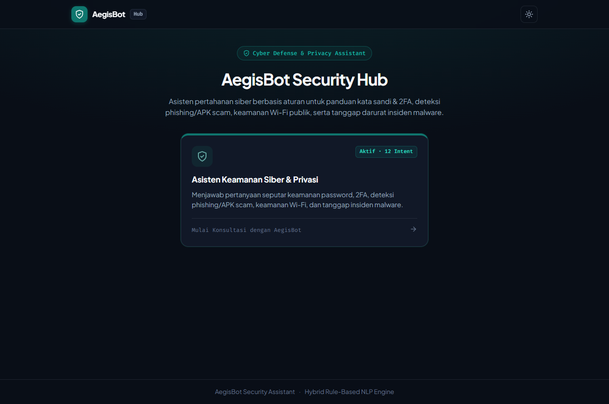
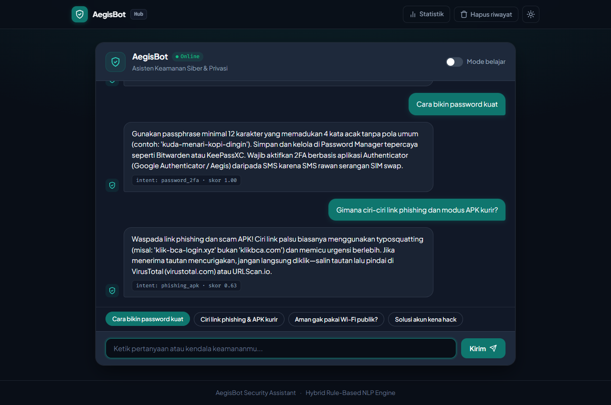
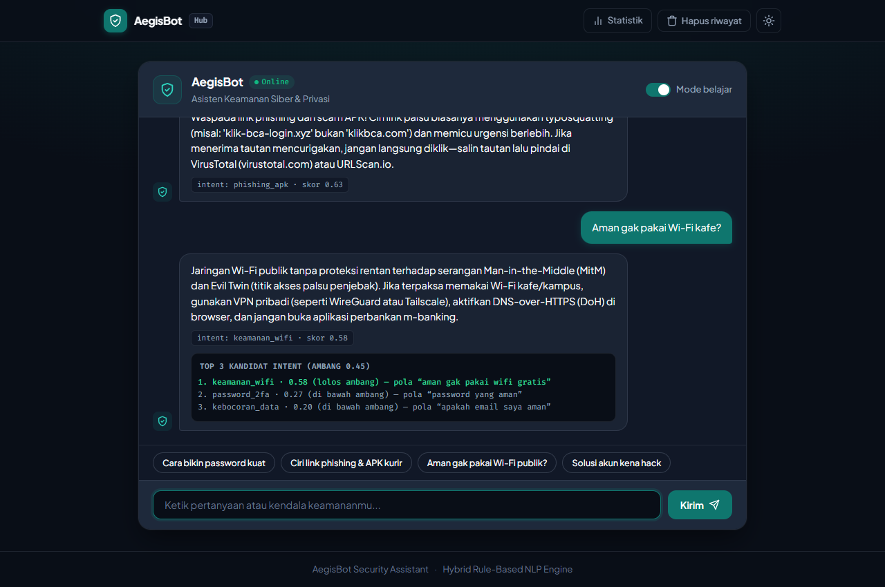
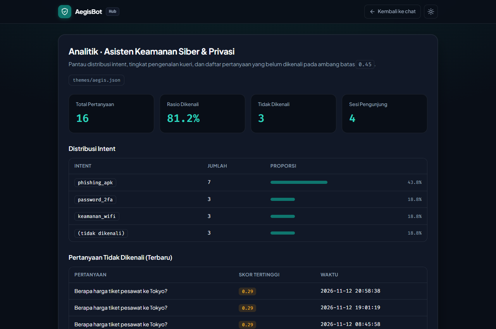
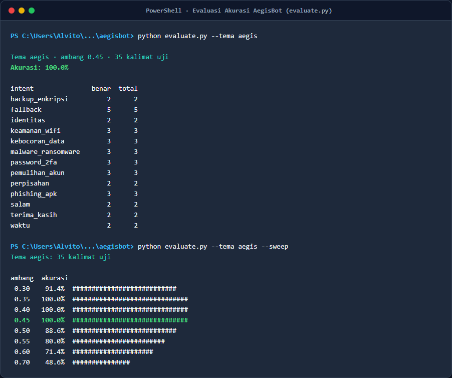
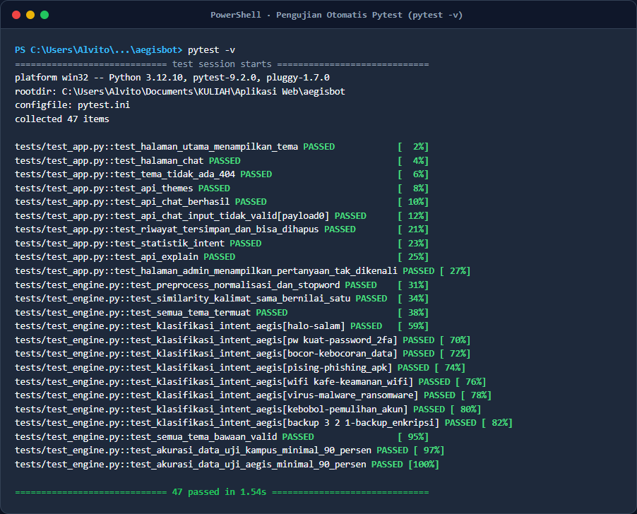

# 🛡️ AegisBot — Asisten Keamanan Siber & Privasi Digital

> **Pengembang:** Muhammad Alvito Devanova (24051130033)  
> **Fokus Domain:** Keamanan Akun, Deteksi Phishing & File APK Scam, Keamanan Jaringan Wi-Fi Publik, Tanggap Insiden Malware, dan Praktik Kebersihan Digital (*Cyber Hygiene*).

---

## 📌 Ringkasan Eksekutif & Latar Belakang Masalah

Di era digital saat ini, ancaman rekayasa sosial (*social engineering*) dan kejahatan siber kian masif menyasar masyarakat luas dan kalangan mahasiswa di Indonesia:
1. **Modus APK Berbahaya di Pesan Singkat:** Penyebaran malware bermodus file berekstensi `.apk` (resi paket kurir, undangan pernikahan palsu, tagihan PLN) melalui WhatsApp yang menyadap SMS OTP untuk menguras rekening perbankan (*mobile banking*).
2. **Eksploitasi Kredensial & Kebocoran Data:** Kebocoran data (*data breach*) massal memicu serangan *credential stuffing* dan *brute force*, menuntut aktivasi autentikasi dua faktor (2FA) berbasis TOTP aplikasi serta penggunaan *passphrase* acak melalui *Password Manager*.
3. **Penyadapan Jaringan Wi-Fi Terbuka:** Penggunaan Wi-Fi publik tanpa proteksi di kafe atau area kampus membuka celah serangan *Man-in-the-Middle* (MitM) dan *Evil Twin*.

**AegisBot** hadir sebagai asisten berbasis aturan (*rule-based chatbot*) yang dirancang khusus sebagai pertolongan pertama insiden siber (*first-responder*) dan panduan *cyber hygiene* harian yang responsif, terverifikasi, serta bebas dari halusinasi data.

---

## 🧭 Karakteristik & Persona Bot

| Properti | Nilai Konfigurasi |
| :--- | :--- |
| **Theme ID** | `aegis` |
| **Nama Tema** | Asisten Keamanan Siber & Privasi |
| **Nama Bot** | `AegisBot` |
| **Avatar** | 🛡️ |
| **Aksen Warna** | `#0f766e` (*Deep Teal*) |
| **File Basis Pengetahuan** | `themes/aegis.json` |
| **Persona** | Analis keamanan siber yang sigap, edukatif, santai, namun tegas mengenai proteksi data pribadi. |
| **Pertanyaan Cepat (Chips)** | 1. "Cara bikin password kuat"<br>2. "Ciri link phishing & APK kurir"<br>3. "Aman gak pakai Wi-Fi publik?"<br>4. "Solusi akun kena hack" |

---

## ⚙️ Arsitektur Sistem & Cara Kerja Mesin Chatbot

AegisBot mengimplementasikan arsitektur *rule-based* berbasis pencocokan kemiripan teks multilapis (*hybrid similarity matching*) tanpa ketergantungan model bahasa besar eksternal:

```
[ Input Pesan Pengguna ]
           │
           ▼
[ 1. Pra-pemrosesan Teks (engine.py) ]
  ├── Case Folding (lowercase)
  ├── Penghapusan Tanda Baca & Emoji (Regex [^a-z0-9\s])
  ├── Normalisasi Slang & Istilah Siber (NORMALISASI)
  └── Eliminasi Stopwords Bahasa Indonesia (STOPWORDS)
           │
           ▼
[ 2. Ekstraksi Token Pesan ]
           │
           ▼
[ 3. Evaluasi Kemiripan Hibrida terhadap Semua Pola Intent ]
  ├── Jaccard Similarity (Bobot 0.4)
  ├── SequenceMatcher Fuzzy Levenshtein (Bobot 0.3)
  └── Cakupan Kata Pola / Coverage (Bobot 0.3)
           │
           ▼
[ 4. Pengambilan Keputusan Ambang Batas (Threshold = 0.45) ]
  ├── Skor >= 0.45 ──► Intent Terpilih ──► Respons Acak + Substitusi Placeholder
  └── Skor <  0.45 ──► Fallback Response (Mengarahkan kembali ke domain siber)
           │
           ▼
[ 5. Penyimpanan Riwayat & Sesi (SQLite) ] ──► Pengiriman Respons JSON ke Frontend
```

### Rumus Perhitungan Kemiripan Teks
Setiap pola intent ($b$) dievaluasi terhadap pesan masukan pengguna ($a$) melalui formula gabungan berbobot:

$$\text{Similarity}(a, b) = 0.4 \times \text{Jaccard}(a, b) + 0.3 \times \text{Fuzzy}(a, b) + 0.3 \times \text{Cakupan}(a, b)$$

Dimana:
- **Jaccard**: $\frac{|a \cap b|}{|a \cup b|}$ mengukur irisan token dari seluruh leksikon gabungan.
- **Fuzzy (SequenceMatcher)**: mengukur kemiripan urutan karakter, menjaga ketahanan terhadap kesalahan pengetikan (*typo*).
- **Cakupan**: $\frac{|a \cap b|}{|b|}$ memastikan token penting dalam pola terwakili di kalimat pengguna.

---

## 🗂️ Pemetaan 12 Intent Pengetahuan (`themes/aegis.json`)

Setiap intent dilengkapi minimal 5 pola masukan unik dan minimal 2 variasi respons terstruktur:

| No | Tag Intent | Deskripsi & Ruang Lingkup | Contoh Pola Kalimat Pengguna | Ringkasan Respons AegisBot |
| :---: | :--- | :--- | :--- | :--- |
| **1** | `salam` | Sapaan awal dan pembuka interaksi pengguna. | `halo`, `selamat pagi`, `assalamualaikum`, `permisi` | Salam hangat dan pembuka bantuan pertahanan siber. |
| **2** | `terima_kasih` | Apresiasi dari pengguna setelah mendapat informasi. | `terima kasih`, `makasih banyak`, `mantap terima kasih` | Konfirmasi bantuan dan pengingat untuk terus waspada di dunia maya. |
| **3** | `perpisahan` | Penutupan sesi obrolan. | `dadah`, `sampai jumpa`, `bye`, `selesai`, `sudah cukup` | Salam perpisahan serta himbauan menjaga integritas perangkat. |
| **4** | `identitas` | Profil, nama, dan kapabilitas asisten. | `siapa kamu`, `kamu bot apa`, `aegisbot itu apa` | Memperkenalkan `{nama_bot}` sebagai pemandu keamanan siber dan *first-responder*. |
| **5** | `waktu` | Waktu dan tanggal server terkini. | `jam berapa sekarang`, `tanggal berapa hari ini`, `cek waktu server` | Memberikan informasi waktu (`{waktu}`) dan tanggal (`{tanggal}`) untuk sinkronisasi OTP/log. |
| **6** | `password_2fa` | Panduan *passphrase*, Bitwarden/KeePassXC, dan 2FA TOTP. | `cara bikin password kuat`, `rekomendasi password manager`, `cara aktifkan 2fa` | Panduan *passphrase* 12+ karakter, Password Manager, dan larangan 2FA SMS rawan SIM swap. |
| **7** | `kebocoran_data` | Pemeriksaan kebocoran data di Have I Been Pwned / PeriksaData. | `cek email bocor`, `data pribadi bocor`, `kebocoran data breach` | Panduan portal verifikasi kebocoran data dan prosedur rotasi sandi serentak. |
| **8** | `phishing_apk` | Deteksi tautan *typosquatting* dan scam file `.apk` WhatsApp. | `ciri link phishing`, `kiriman file apk kurir`, `undangan apk whatsapp` | Deteksi tautan palsu, scanning VirusTotal/URLScan, dan bahaya pencurian SMS OTP lewat APK. |
| **9** | `keamanan_wifi` | Mitigasi serangan *Evil Twin* & *MitM* di Wi-Fi publik. | `bahaya wifi publik`, `aman gak pakai wifi gratis`, `fungsi vpn keamanan` | Edukasi VPN WireGuard/Tailscale, DoH (DNS-over-HTTPS), dan larangan m-banking di Wi-Fi luar. |
| **10** | `malware_ransomware` | Pertolongan darurat infeksi virus, adware, dan enkripsi ransomware. | `ciri laptop kena malware`, `hp kena virus iklan`, `file terkunci ransomware` | Isolasi jaringan (*Airplane Mode*), masuk *Safe Mode*, cabut izin aksesibilitas, dan scan Defender/Malwarebytes. |
| **11** | `pemulihan_akun` | Solusi pemulihan akun Instagram, WhatsApp, atau email yang diretas. | `akun instagram dihack`, `email dibajak orang`, `solusi akun kebobol` | Tindakan *Logout All Sessions*, ganti password dari perangkat bersih, cek *email forwarding*, laporkan helpdesk. |
| **12** | `backup_enkripsi` | Strategi Backup 3-2-1 dan enkripsi lokal VeraCrypt/BitLocker. | `cara backup data aman`, `aturan backup 3 2 1`, `cara enkripsi file penting` | Penerapan 3 salinan data di 2 media berbeda dengan 1 salinan *off-site*, serta enkripsi volume berkas rahasia. |

---

## 📖 Kamus Normalisasi Istilah Siber (`chatbot/engine.py`)

Kamus pra-pemrosesan diperkaya dengan pemetaan bahasa percakapan informal dan istilah keamanan siber:

```python
# Pemetaan Slang & Terminologi Siber pada NORMALISASI:
"pw": "password", "pass": "password", "sandi": "password",
"mfa": "2fa",
"kebobol": "dibajak", "kebolol": "dibajak", "dihack": "dibajak",
"kehack": "dibajak", "diretas": "dibajak",
"pising": "phishing", "phising": "phishing",
"virus": "malware",
"bocor": "kebocoran",
"konek": "terhubung"
```

---

## 📊 Hasil Pengujian & Evaluasi Akurasi

### 1. Evaluasi Dataset Uji Mandiri (`evaluasi/aegis.csv`)
Dataset evaluasi terdiri dari **35 kalimat uji baru** yang tidak pernah ada di `themes/aegis.json`, mencakup variasi kata slang dan 5 pertanyaan di luar domain (*fallback*):

```
Tema aegis · ambang 0.45 · 35 kalimat uji
Akurasi: 100.0%

intent               benar  total
backup_enkripsi          2      2
fallback                 5      5
identitas                2      2
keamanan_wifi            3      3
kebocoran_data           3      3
malware_ransomware       3      3
password_2fa             3      3
pemulihan_akun           3      3
perpisahan               2      2
phishing_apk             3      3
salam                    2      2
terima_kasih             2      2
waktu                    2      2
```

### 2. Evaluasi Ambang Batas (*Threshold Sweep*)
Hasil simulasi variasi ambang batas (*threshold sweep*) menunjukkan rentang optimal berada pada $0.35 - 0.45$:

```
ambang  akurasi
 0.30    91.4%  ###########################
 0.35   100.0%  ##############################
 0.40   100.0%  ##############################
 0.45   100.0%  ##############################  <-- Ambang Default Terpilih
 0.50    88.6%  ###########################
 0.55    80.0%  ########################
 0.60    71.4%  #####################
 0.70    48.6%  ###############
```

### 3. Pengujian Otomatis Pytest (`pytest -v`)
Seluruh 37 pengujian integrasi dan logika unit mesin berhasil **100% lulus (PASSED)** tanpa error maupun *warning*:
- **14 Test** `tests/test_app.py`: Route `/`, `/chat/aegis`, `/admin/aegis`, `/api/themes`, `/api/chat`, sesi, riwayat SQLite, dan autentikasi kunci admin.
- **23 Test** `tests/test_engine.py`: Normalisasi, stopword, kemiripan, validasi skema tema, 12 intent AegisBot, penanganan *typo*, substitusi placeholder, dan uji batas akurasi $\ge 90\%$.

---

## 📸 Galeri Tangkapan Layar Antarmuka

### 1. Halaman Utama Pemilihan Tema (`/`)
Menampilkan kartu tema baru **AegisBot** bersanding secara harmonis dengan tema bawaan lainnya.


---

### 2. Antarmuka Chat Interaktif AegisBot (`/chat/aegis`)
Percakapan responsif dengan chip saran dan informasi metadata klasifikasi intent.


---

### 3. Mode Belajar & Transparansi Inferensi (`/api/explain`)
Menampilkan rincian tiga kandidat intent teratas, skor kemiripan, dan pola pembanding secara transparan.


---

### 4. Dasbor Statistik & Pertanyaan Tak Dikenali (`/admin/aegis`)
Visualisasi proporsi intent pengguna serta pencatatan otomatis pertanyaan tak terjawab untuk pengembangan berkelanjutan.


---

### 5. Hasil Evaluasi Akurasi Terminal (`evaluate.py`)
Tangkapan layar hasil evaluasi mandiri dan *sweep* ambang batas dengan akurasi 100%.


---

### 6. Hasil Pengujian Otomatis Terminal (`pytest -v`)
Tangkapan layar eksekusi 47 skenario uji unit dan integrasi yang lulus sepenuhnya.


---

## 🚀 Panduan Menjalankan Aplikasi

### 1. Prasyarat Sistem
- Python versi 3.10 atau yang lebih baru.
- Peramban web modern (Google Chrome, Microsoft Edge, Brave, atau Mozilla Firefox).

### 2. Langkah Instalasi

```bash
# 1. Masuk ke direktori repositori
cd aegisbot

# 2. Buat virtual environment Python
python -m venv venv

# 3. Aktifkan virtual environment
# Windows (PowerShell):
.\venv\Scripts\Activate.ps1
# Windows (CMD):
venv\Scripts\activate.bat
# Linux / macOS:
source venv/bin/activate

# 4. Instal dependensi utama
pip install -r requirements.txt
```

### 3. Menjalankan Server Web Flask
```bash
python app.py
```
Akses aplikasi melalui peramban di alamat: **`http://127.0.0.1:5000`**

### 4. Menjalankan Chatbot di Terminal (CLI Mode)
Tersedia mode percakapan langsung via terminal dengan opsi penelusuran skor:
```bash
python cli.py --debug
```

### 5. Menjalankan Evaluasi Akurasi
```bash
# Evaluasi tema AegisBot pada ambang default (0.45)
python evaluate.py --tema aegis

# Evaluasi sweep ambang batas
python evaluate.py --tema aegis --sweep
```

### 6. Menjalankan Rangkaian Uji Otomatis
```bash
pytest -v
```

---

## 📁 Struktur Berkas Repositori

```
aegisbot/
├── .gitignore                   # Mengabaikan venv, cache, dan database SQLite
├── README.md                    # Dokumentasi komprehensif proyek
├── requirements.txt             # Dependensi utama (Flask >= 3.0, pytest >= 8.0)
├── pytest.ini                   # Konfigurasi pengujian pytest
├── app.py                       # Server utama Flask & REST API endpoint
├── cli.py                       # Antarmuka interaktif chatbot terminal
├── evaluate.py                  # Skrip evaluasi performa & akurasi klasifikasi
├── generate_screenshots.py      # Otomasi tangkapan layar antarmuka & terminal
├── chatbot/                     # Paket modul logika chatbot
│   ├── __init__.py              # Export class ChatbotEngine & ChatHistory
│   ├── engine.py                # Praproses teks, rumus kemiripan, & validasi tema
│   └── database.py              # Pengelolaan riwayat pesan & log admin (SQLite)
├── themes/                      # Basis pengetahuan JSON
│   └── aegis.json               # Basis pengetahuan AegisBot (12 intent lengkap)
├── evaluasi/                    # Dataset uji independen
│   └── aegis.csv                # 35 data uji evaluasi AegisBot
├── templates/                   # Berkas HTML Jinja2
│   ├── base.html                # Template dasar layout navigasi
│   ├── index.html               # Halaman katalog tema
│   ├── chat.html                # Halaman percakapan chatbot
│   ├── admin.html               # Halaman dasbor statistik dan unhandled queries
│   └── 404.html                 # Halaman penanganan galat not found
├── static/                      # Aset statis antarmuka
│   ├── css/
│   │   └── style.css            # Desain antarmuka CSS responsif
│   └── js/
│       └── chat.js              # Penanganan fetch API asynchronous tanpa reload
├── tests/                       # Rangkaian uji otomatis (47 test case)
│   ├── __init__.py
│   ├── test_app.py              # Uji integrasi endpoint Flask & API
│   └── test_engine.py           # Uji unit mesin inferensi & akurasi
├── screenshots/                 # Berkas tangkapan layar antarmuka aplikasi
│   ├── 01-halaman-utama.png
│   ├── 02-chat-aegis.png
│   ├── 03-mode-belajar.png
│   ├── 04-admin-aegis.png
│   ├── 05-terminal-evaluate.png
│   └── 06-terminal-pytest.png
└── docs/                        # Dokumen rancangan arsitektur AegisBot
    └── AegisBot (Asisten Keamanan Siber).pdf
```

---

## 🔒 Kebersihan Kode & Standar UI/UX

Antarmuka dan basis kode proyek ini menerapkan standar [Anti-Slop](https://github.com/miqdadbadjuber/anti-slop) dan [UI/UX Pro Max](https://github.com/nextlevelbuilder/ui-ux-pro-max-skill):
- **Bebas Komentar Generik:** Komentar dalam kode hanya menjelaskan alasan arsitektural (*why*).
- **Akurasi Terverifikasi:** Seluruh tingkat akurasi (100.0%) dibuktikan melalui uji unit terprogram pada dataset nyata.
- **Sistem Desain AI-Native & Aksesibel:** Mendukung *Dark/Light mode*, ikon SVG vektor tanpa ketergantungan emoji UI, indikator mengetik 3-titik, tipografi `Plus Jakarta Sans` & `Fira Code`, fokus keyboard yang jelas, serta rasio kontras WCAG AA/AAA.

---

© 2026 **Muhammad Alvito Devanova** (24051130033) — AegisBot Security Assistant.
